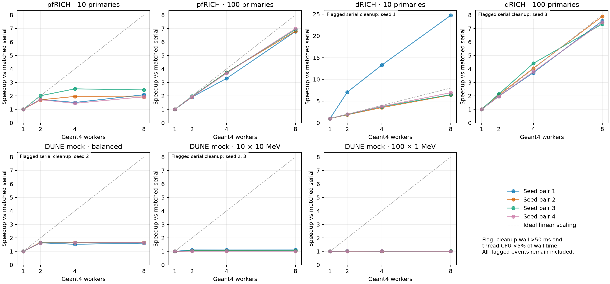
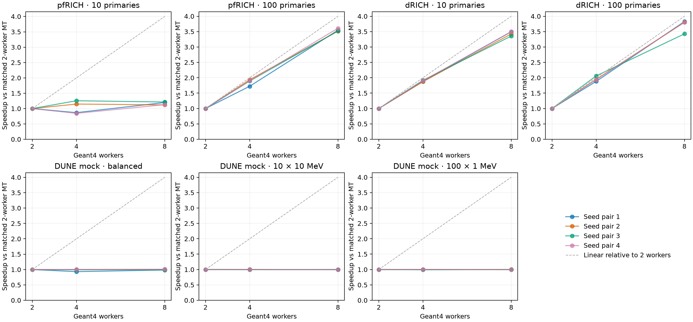

# Findings from measured multithreaded Geant4 runs

Measurements completed on 13 November 2026 (America/New_York); archived timestamps use UTC. This campaign repeats the seven electron workloads bundled with the published serial timeline notebook.

| Control | Coverage |
|---|---|
| Workloads | pfRICH and dRICH at 10/100 electrons, 20 GeV/c; DUNE mock at 65,536 × 1 keV, 10 × 10 MeV, and 100 × 1 MeV kinetic |
| Execution | Serial control plus 2, 4, and 8 Geant4 workers; one ordered GPU gate |
| Seed pairs | 50111/2100011; 60223/2200033; 70339/2300051; 80447/2400077 |
| Per run | 516 raw events; 16 predeclared warm-up events; 500 retained |
| Replication | Four runs and 2,000 retained events per workload/worker setting |
| Primary dataset | 112 runs; 57,792 raw events; 56,000 retained |
| Runtime | One fresh Release build of Simphony PR 462 merge `2c878526827c8d02aa48dbc8a83063c19e593272`; Teerex `81de2cb8b85082954731075d6aacf56650d1c30e` |
| Hardware | Xeon w7-3445, affinity to physical cores 2–17; one RTX 4090, physical GPU 0; shared host |

The 100-primary RICH cases benefit strongly from additional CPU workers. Balanced DUNE reaches its throughput plateau by two workers, while both GPU-heavy DUNE cases gain little. The small pfRICH case also approaches its GPU-gate limit, with more variable subsecond measurement windows.

| Workload | 8/serial speedup, median [range] | 8/2-worker MT speedup, median | GPU gate occupied at 8 workers, median |
|---|---:|---:|---:|
| pfRICH · 10 primaries | 2.01 [1.91, 2.44] | 1.16 | 97.72% |
| pfRICH · 100 primaries | 6.86 [6.77, 6.99] | 3.53 | 79.91% |
| dRICH · 10 primaries † | 6.70 [6.41, 24.71] | 3.46 | 68.23% |
| dRICH · 100 primaries | 7.50 [7.33, 7.89] | 3.80 | 28.81% |
| DUNE mock · balanced | 1.64 [1.61, 1.66] | 1.00 | 99.96% |
| DUNE mock · 10 × 10 MeV | 1.04 [1.01, 1.11] | 1.00 | 99.96% |
| DUNE mock · 100 × 1 MeV | 1.01 [1.01, 1.02] | 1.00 | 99.98% |

Each ratio pairs runs with the same seed labels. Serial and MT Geant4 initialize their RNGs differently, so these labels do not imply identical serial/MT event histories. The 8/2-worker comparison stays entirely within MT, where retained counts and hit bytes match exactly. Ranges describe the four runs; they are not confidence intervals.

† The dRICH 10-primary range includes a delayed first-seed serial control. Its 24.71× ratio is not a clean scaling result. The other three primary seeds give 6.41–6.93×. A separate repeat of the affected seed gives 6.72×, with each repeat matching its corresponding primary history and no flagged cleanup stalls. All original runs remain in the primary statistics.

The DUNE GPU gate is already occupied about 99.97–99.98% of the retained window at two workers. Increasing to eight workers adds essentially no throughput: median 8/2 ratios are 0.998, 0.997, and 0.998 for balanced, 10-primary, and 100-primary DUNE. Median queue waits at eight workers are about 1.71, 2.14, and 2.09 seconds respectively. These observations support a shared-gate bottleneck for the tested worker counts. Gate occupancy includes locked cleanup and is not hardware SM utilization.

Throughput is `500 / (last retained GPU-gate release − event-15 GPU-gate release)`. CPU coverage, GPU service, gate occupancy, and CPU/GPU overlap use interval unions clipped to that same window. The [interactive notebook](../../notebooks/mt_timelines.py) shows generation, queue waiting, GPU calls, and cleanup on separate worker lanes, with each process on its own clock. Host-observed GPU service includes staging, transfers, and synchronization.

Validation passed for all 112 runs and all 28 workload/seed groups. Fresh serial counts match the preserved serial histories on overlapping event IDs. Retained MT counts and GPU-hit hashes match across 2/4/8 workers. [Initial count differences](warmup-differences.json) occur only at raw event IDs 2–7 in 24 of the 56 comparisons against two workers; the predeclared 16-event warm-up excludes them. All raw records remain available.

Changing warm-up cutoffs to 8/16/32 and dropping 0/8/16 final events changes per-run throughput by −3.57% to +1.93% relative to the main window. Batch-span rates differ from completion rates by at most 1.60%. This supports the window definition, but it does not remove the cleanup-stall anomaly.

The smallest pfRICH completion windows span only 0.304–0.767 seconds. Four seed pairs provide descriptive replication on a shared host, not a precise confidence interval or an isolated hardware limit. The earlier serial campaign used the other GPU, so historical wall-time comparisons are descriptive. This study measures synchronous workers and serialized GPU launches; it does not fit a Bayesian model or measure asynchronous dispatch.

[Evidence and definitions](README.md) · [Run summaries](run-summary.csv) · [Sensitivity](sensitivity.csv) · [Cleanup diagnostics and confirmation](DIAGNOSTICS.md) · [Original campaign verification](verification.json)
